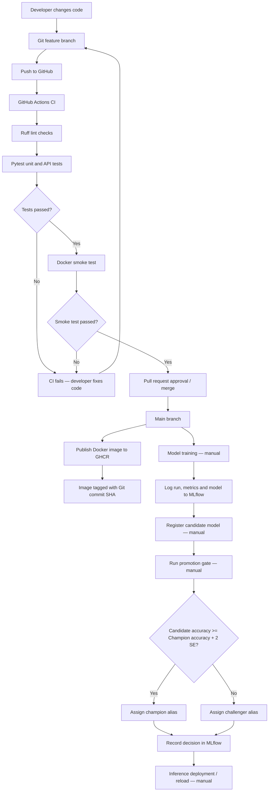



# Lab 5 — CI/CD and Model Promotion Pipeline

## Pipeline Diagram

## Automatic Steps

\- GitHub Actions starts on pushes and pull requests.

\- Ruff checks code style and import formatting.

\- Pytest executes unit and API tests.

\- The Docker smoke job runs after the test job succeeds.

\- Docker image publishing to GHCR runs after successful checks on `main`.

\- Published images are tagged with the Git commit SHA.

## Manual Steps

\- Developer fixes failed tests and opens or updates a pull request.

\- Developer merges the pull request after required checks pass.

\- Model training is launched manually.

\- Candidate models are registered manually in MLflow.

\- The promotion gate is executed manually.

\- Deployment or reloading of the selected model requires a separate action.

## Code and Model Versions

\*\*Code version:\*\* Identified by the Git commit SHA and the corresponding GHCR image tag.

\*\*Model version:\*\* Identified by the MLflow registered model name (`food11`), version number, and alias (`champion` or `challenger`).

These version identifiers are independent. Publishing a new Docker image does not automatically promote a model.

## Actual Lab 5 Results

The pull request experiment demonstrated:

1\. An intentionally failing unit test caused the `test` job to fail.

2\. The dependent `smoke` job was skipped.

3\. After correcting the test, the required checks passed.

4\. Pull Request #1 was merged into `main`.

The MLflow quality-gate experiment produced:

| Version | Test Accuracy | Promotion Decision |

|---|---:|---|

| 1 | 0.762774 | Existing champion |

| 2 | 0.756387 | REJECTED |

| 3 | 0.750000 | REJECTED |

Evaluation set size: 1,096 images.

Promotion threshold against champion v1: approximately 0.788472.

The original mini dataset contained cross-split duplicate images. Consequently, these results demonstrate the promotion workflow but may be affected by data leakage.

